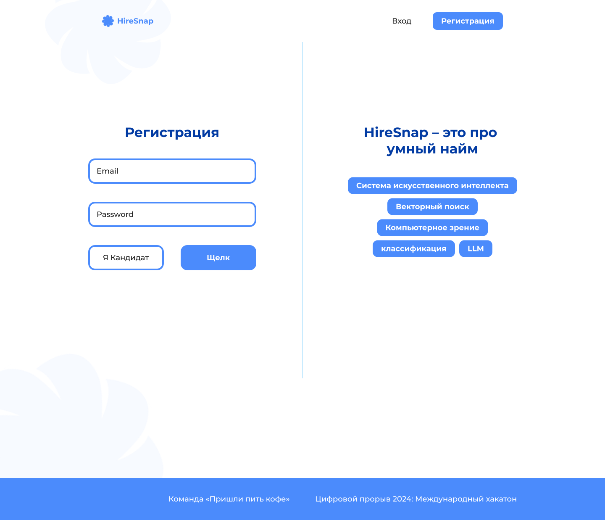
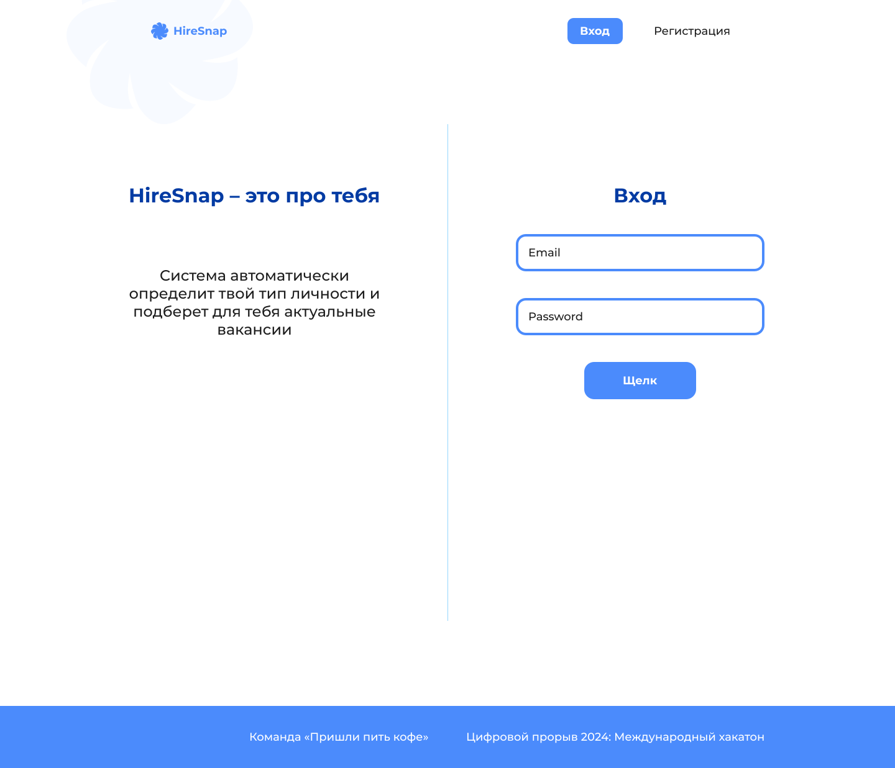
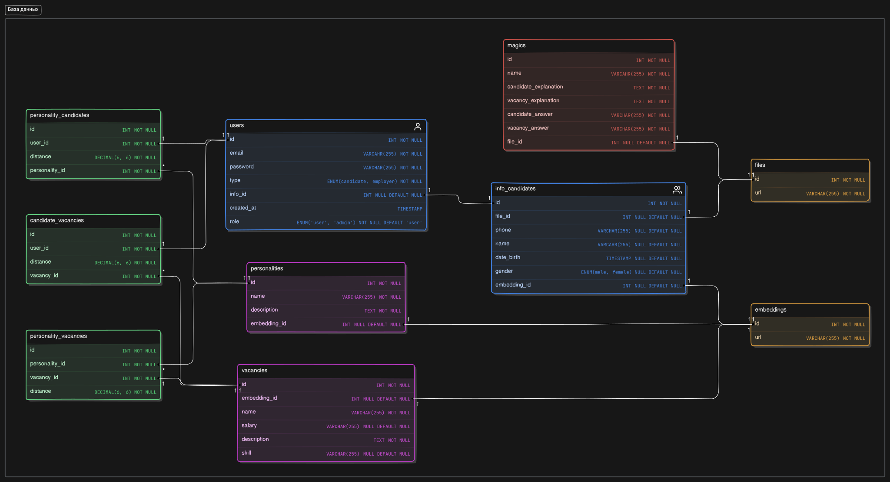

#

> **Language note.** This is the product README, kept in the project's original
> language: what HireSnap is, what the screens look like, and the OCEAN/MBTI story.
> The authoritative English documents are [`AGENTS.md`](../AGENTS.md) for working
> conventions and [`docs/`](../docs/) for architecture, environment, contracts and the
> runbook. The install, run and test commands below are current as of the `service/`
> package refactor — if a path here ever disagrees with `docs/`, `docs/` wins.

|  | <a href="https://git.io/typing-svg"></a> |
|-----------------------------------------------------------------------|--------------------------------------------------------------------------------------------------------------------------------------------------------------------------------------------------------------------------------------------------------|


---

**HireSnap** — инструмент для оценки кандидатов на основе анализа их личностного типа по системе OCEAN. Тип личности каждого кандидата определяется на основе видео-визитки, где модель анализирует как речь, так и визуальные характеристики (возможно, эмоции). Инструмент также позволяет перевести оценку личности по системе OCEAN в систему MBTI, таким образом предоставляя два типа оценок личности. Работодатели могут использовать **HireSnap** для ранжирования кандидатов по степени соответствия их личностных черт требованиям вакансии, что упрощает подбор подходящих сотрудников на основе личностных характеристик.

---


### Внешний вид графического интерфейса на React:

|  |  |
|------------------------------------------------|--------------------------------------------------|


Все страницы сайта можно посмотреть [**здесь**](docs/images/HireSnap.pdf) <br/>
Презентация проекта находится [**здесь**](docs/images/HireSnap_presentation.pdf)


- [Структура репозитория](#структура-репозитория)
- [Необходимые требования](#требования)
- [Установка и настройка](#установка-и-настройка)
  - [Установка виртуальной среды и зависимостей](#1-установка-виртуальной-среды-и-зависимостей)
  - [Запуск сервера](#2-запуск-сервера)
  - [Запуск тестов](#3-запуск-тестов)
  - [Переменные среды](#переменные-среды)

## Структура репозитория

```
    HireSnap/
    ├── database/
    |   └── HireSnap.sql - sql скрипт для создания базы данных
    ├── docker/
    |   ├── Dockerfile - образ сервиса (python:3.9-slim, CMD python -m service.main)
    |   └── requirements.lock.txt - зафиксированный снимок зависимостей
    ├── docs/
    |   ├── PLATFORM_LAYER.md - описание слоя платформы
    |   └── images/ - картинки и презентации для этого README
    ├── logs/ - Папка для хранения логов
    |   └── app.log
    ├── notebooks/ - исследовательские ноутбуки
    ├── service/ - сам сервис
    |   ├── main.py - точка входа: bootstrap схемы (DEBUG и INIT_DB) и uvicorn
    |   ├── settings.py - типизированные настройки: get_settings() читает окружение один раз
    |   ├── api/ - app.py (create_app, три монтирования, CORS, GET /server/health,
    |   |            обработчик ServiceError), registry.py (порядок роутеров), security.py
    |   ├── composition/ - единственное место сборки: infra -> repositories -> services
    |   ├── configuration/ - env.py (совместимый шим Env), logging.py, logging.yaml, paths.py
    |   ├── models/ - db_models.py и auth_models.py: pydantic-модели, общие для слайсов
    |   ├── infrastructure/ - cache, storage, mail, uploads, ml_sidecar.py, database/, messaging/
    |   ├── services/<домен>/ - вертикальные слайсы: auth, users, candidates, vacancies,
    |   |                      magics, personalities, personality_vacancies,
    |   |                      personality_candidates, candidate_vacancies, files,
    |   |                      embeddings, matching, jobs; внутри domain/, application/,
    |   |                      persistence/ и presentation/routers/<домен>_api/
    |   └── shared/ - errors.py (ServiceError и его подклассы), hashing, tokens,
    |                validation, urls, debug
    ├── scripts/ - check_backend_layout.py: те же правила раскладки без pytest
    ├── tests/ - pytest (conftest.py, структурные, контрактные и слайс-тесты,
    |            fixtures/fake_db.py, snapshots/critical_endpoint_openapi.json)
    ├── .env - переменные среды
    ├── pyproject.toml - метаданные проекта, ruff, mypy, pytest и порог покрытия
    ├── requirements.txt - список зависимостей
    ├── requirements-platform.txt - celery/redis/boto3, нужны только воркерам
    └── README.md - этот файл
```


### Реляционная база данных:




## Требования
- Python 3.9+
- MySQL 5.7 (в стеке — контейнер `mysql`, схема поднимается из `database/HireSnap.sql`)
- `ml/` рядом: эмбеддинги и транскрипция — это HTTP-вызовы, без них сервис отдаёт
  `503 service_unavailable` на загрузке видео и работает на всех остальных маршрутах


## Установка и настройка

### 1. Установка виртуальной среды и зависимостей

* Клонируйте репозиторий на сервер:
  ```cmd
    git clone https://github.com/Prischli-Drink-Coffee/HireSnap.git
    cd HireSnap/backend
  ```

* Создайте виртуальную среду и установите зависимости:

  **Linux/MacOS**

  ```bash
    python3 -m venv venv
    source venv/bin/activate
    pip install -r requirements.txt
  ```

  **Windows**
  ```cmd
    python -m venv venv
    venv\Scripts\activate
    pip install -r requirements.txt
  ```

  `requirements.txt` больше не содержит ML-стек: ни `torch`, ни CUDA, ни
  `transformers` — инференс уехал в `ml/`. `requirements-platform.txt` нужен только
  воркерам и S3-образу (`celery`, `redis`, `boto3`).

### 2. Запуск сервера

* Из каталога `backend/`:
    ```bash
    python -m service.main
    ```
  Точка входа — `service/main.py`; она поднимает `uvicorn` на `HOST`:`SERVER_PORT`
  и включает `reload`, только если `DEBUG=TRUE`.
* Если `DEBUG=TRUE` и `INIT_DB` истинны, при старте создаётся схема из
  `database/HireSnap.sql` (см. `service/infrastructure/database/schema.py`).

### 3. Запуск тестов

Из каталога `backend/`:

```bash
python -m pytest -q
```

`tests/conftest.py` кладёт каталог `backend/` в `sys.path`, поэтому тесты видны без
установки пакета. Отдельного ручного прогона пайплайна в этом пакете больше нет:
инференс переехал в `ml/` (`python service/app.py`), и вызывается он по HTTP.

Покрытие ветвей `service/` проверяется отдельной целью `make coverage` (из корня
репозитория): порог лежит в `pyproject.toml` (`[tool.coverage.report] fail_under`), а
запускается CLI `coverage`, а не `pytest --cov`, потому что pytest-cov читает
`.coveragerc` и игнорирует `pyproject.toml`. Помеченных `xfail` тестов больше нет: дефект
из `docs/KNOWN_GAPS.md` §26 (ссылка «вакансия — личность» писалась не той личности) закрыт
вместе со своим `strict=True`-маркером, и теперь это обычный проходящий тест.

### Переменные среды

Сервер читает переменные среды через `service/configuration/env.py` (а локально —
из `backend/.env`). Минимально нужны:

```markdown
  HOST=0.0.0.0 <br/>
  SERVER_PORT=8080 <br/>
  DEBUG=TRUE <br/>
  INIT_DB=TRUE <br/>
  DATA_PATH=./data <br/>
  DB_HOST=HOST <br/>
  DB_PORT=PORT <br/>
  DB_USER=USER <br/>
  DB_PASSWORD=PASSWORD <br/>
  DB=DATABASE <br/>
  PUBLIC_BASE_URL=http://localhost:8080/api/ <br/>
  JWT_PRIVATE_KEY_PATH=./certs/jwt-private.pem <br/>
  JWT_PUBLIC_KEY_PATH=./certs/jwt-public.pem <br/>
  ACCESS_TOKEN_EXPIRE_MINUTES=60 <br/>
  REFRESH_TOKEN_EXPIRE_DAYS=7 <br/>
  CORS_ALLOW_ORIGINS=* <br/>
  ML_SERVICE_URL=http://127.0.0.1:8080 <br/>
```

Здесь имена плоские: `service/infrastructure/database/connection.py:40` читает ровно
`DB_HOST`, `DB_PORT`, `DB_USER`, `DB_PASSWORD`, `DB`. В манифесте `docker/.env.example`
они записаны как `DB__HOST`, `DB__PORT`, `DB__USER`, `DB__PASSWORD`, `DB__NAME`, а compose
разворачивает их в плоские при подстановке — единственное место, где это происходит.
Полный список ключей — `docker/.env.example` и [docs/ENV.md](../docs/ENV.md).


## Инференс модели определения типа личности (OCEAN)

> **Код перенесён в `ml/`.** Пайплайн инференса больше не живёт в `backend/`: он
> вынесен в отдельный сервис `ml/` (третий сабмодуль, HTTP API). Модули
> `src/modelling/*` и `cosmos_tokenizer/` удалены; их копии лежат в `ml/service/`
> (`video_to_text.py`, `text_embedding.py`, `frames.py`, `video_embedding.py`,
> `user_embedding.py`), и команды ниже уже указывают туда. Источник истины по
> контракту — `ml/README.md`.
> В обычной работе вызывать их вручную не нужно: эмбеддинги и транскрипция — это
> `POST /v1/embed/video`, `POST /v1/embed/text` и `POST /v1/transcribe` по адресу
> `ML_SERVICE_URL` (в стеке `http://ml:8080`), а из этого дерева их вызывает
> `service/infrastructure/ml_sidecar.py`. Скрипта `inference.sh` в дереве больше нет.

Раньше оценки личности по системам MBTI и OCEAN для набора видео-визиток считал
пакетный скрипт `inference.sh`; он удалён вместе с `src/modelling/`, а папки
`src/`, `setup/`, `main.sh`, `setup.sh`, `pm2.sh`, `create_sql.py` и `env.py` больше
не существуют. Сегодня тот же результат даёт HTTP-вызов к `ml/`:

```bash
  # внутри стека: docker compose exec ml ... либо с хоста по ML_SERVICE_URL
  curl -fsS -X POST http://127.0.0.1:8080/v1/embed/video \
    -H 'content-type: application/octet-stream' \
    -H 'x-filename: candidate.mp4' \
    --data-binary @candidate.mp4
```

Ответ — `{"vector", "dim", "model"}`; транскрипция — `POST /v1/transcribe` с теми же
заголовками. Контракт, коды ошибок и ограничения по размеру описаны в `ml/README.md`,
а вызывающий код в этом дереве — `service/infrastructure/ml_sidecar.py` (он же задаёт
`ML_SERVICE_URL`, по умолчанию `http://127.0.0.1:8080`).

## Пайплайн определения типа личности (OCEAN)

> **Историческое описание.** Ниже — как был устроен пайплайн, пока код лежал в
> `backend/src/modelling/`. Сегодня этот код находится в `ml/service/`, а команды
> `python src/modelling/...` не разрешаются. Описание *алгоритма* (текстовые и
> видео-эмбеддинги, объединение модальностей, оценка OCEAN/MBTI) по-прежнему
> верно — неверны только способы запуска. Обучения модели сейчас нет ни здесь, ни
> в `ml/`: `train.py` удалён вместе с `src/modelling/`, сервис умеет только
> инференс, а веса монтируются в контейнер из `infra/models/`.

Если Вы хотите обучить модель на своих данных, Вы можете следовать нашему пайплайну. Его также можно использовать и для инференса модели (заместо предыдущего пункта) - тогда пропустите шаг с обучением модели.

### I. Получение текстовых эмбеддингов
Основная модальность работы нашего инструмента - текст. Мы получаем векторные представления для речи кандидата, описания вакансии, а также описания характеристик системы OCEAN. Данные векторные представления мы получаем из предобученный *BERT-like* модели.

1. **Текстовый эмбеддинг речи кандидата.**

Для того, чтобы получить текстовое представление для видео-визитки, мы транскрибируем аудио из видео-визитки в текст. Транскрипция аудио осуществляется с помощью предобученной модели *wav2vec2*. Чтобы получить текстовое представление для речи кандидата, запустите в командной строке:

```bash
  # из каталога ml/ (модули лежат в ml/service/, PYTHONPATH=/app/service в образе)
  python service/video_to_text.py --video_folder_path <video_folder> --audio_folder <audio_folder> --table_path <transcription_table>
```

- `video_folder` - Папка с видео-визитками кандидатов (видео формата `.mp4`)
- `audio_folder` - Промежуточная папка с аудио-файлами, которые были получены из соответствующих видео-визиток. Удаляется после выполнения команды
- `table_path` - Результат выполнения текущей команды. Таблица формата `.csv` с двумя колонками: **candidate**, содержащая наименование видео-файлов, и **speech**, содержаща транскрипцию видео (речь кандидата)

Далее, с помощью предобученной модели BERT необходимо получить текстовое представление речи кандидата. Для этого выполните:

```bash
  python service/text_embedding.py --path_to_texts <transcription_table> --output_folder <user_text_embedding_folder>
```

- `path_to_texts` - Результат выполнения *предыдущей* команды. Таблица формата `.csv` с двумя колонками: **candidate**  и **speech**
- `output_folder` - Папка, в которую будут сохранены текстовые эмбеддинги речи кандидатов (по одному файлу на одну визитку, название файла соответствует изначальному наименованию видео-визитки)

2. **Текстовый эмбеддинг описания вакансии.**

Также с помощью BERT-like модели получаем текстовое представление описания вакансий. Описание вакансий, использованное нами Вы можете найти в [открытом доступе](https://www.kaggle.com/datasets/kshitizregmi/jobs-and-job-description). Вы можете использовать как этот же датасет, так и свой. Получите векторное представление для вакансий следующей командой:

```bash
  python service/text_embedding.py --path_to_texts <vacancies_description_table> --output_folder <vacancies_embedding_folder> --disable_candidates
```

- `path_to_texts` - Таблица формата `.csv` с описанием вакансий. В первой колонке должно быть название вакансии. Во второй колонке - описание этой вакансии
- `output_folder` - Папка, в которую будут сохранены текстовые эмбеддинги описания вакансии (по одному файлу на одну вакансию, название файла соответствует индексу вакансии из входной таблицы)
- `--disable_candidates` - флаг, указывающий на то, что сохранять текстовый эмбеддинг необходимо по индексу вакансии, а не по названию этой вакансии (необходимо было сделать, так как вакансии могут содержать пробелы)

3. **Текстовый эмбеддинг описания характеристик OCEAN.**

Получите векторное представление для характеристик OCEAN (пяти из них) следующей командой:

```bash
  python service/text_embedding.py --path_to_texts <vacancies_description_table> --output_folder <personalities_embedding_folder> --disable_candidates
```

- `path_to_texts` - Таблица формата `.csv` с описанием вакансий. В первой колонке должно быть название характеристики. Во второй колонке - описание этой черты
- `output_folder` - Папка, в которую будут сохранены текстовые эмбеддинги описания характеристики OCEAN (по одному файлу на одну характеристику, название файла соответствует индексу черты из входной таблицы)

### II. Получение видео-эмбеддингов

Видео-эмбеддинг характеризует визуальную информацию о кандидате - он может содержать информацию об эмоциях кандидатов, количестве их движений или степени неуверенности. Для характеристики типа личности данная модальность является важной - "язык тела" о человеке может сказать больше, чем он сам.

1. **Извлечение кадров**
Для получения видео-эмбеддинга необходимо сначала извлечь кадры (frames) - несколько картинок - из каждого видео. Для этого выполните команду:

```bash
  python service/frames.py <video_folder> <frames_folder>
```

- `video_folder` - Папка с видео-визитками кандидатов (видео формата `.mp4`)
- `frames_folder` - Промежуточная папка. Содержит папки с кадрами каждой из видио-визиток (формата `.jpg`)

По умолчанию извлекается 10 кадров в секунду из каждого видео. То есть если длительность Вашего видео 5 секунд, будет извлечено 50 кадров из видео. Частота задаётся константой `FRAMES_PER_SECOND = 10` в `ml/service/frames.py` (не параметром командной строки: это свойство модели, а не производительности — токенизатор обучен на таком потоке кадров). В удалённом `src/modelling/get_frames.py` она была такой же.

2. **Обучение видео-модели**

Мы использовали [Cosmos-Tokenizer](https://github.com/NVIDIA/Cosmos-Tokenizer?tab=readme-ov-file) для получения общего представления о **видео**. Для того, чтобы его запустить, сначала выполните:

```bash
  # было (не выполняется): export PYTHONPATH=$PYTHONPATH:path/to/HireSnap/cosmos_tokenizer
```

> **Устарело.** Отдельная переменная `PYTHONPATH` для `cosmos_tokenizer` больше не
> нужна: пакет вендорен внутрь сервиса (`ml/service/cosmos_tokenizer/`) и
> импортируется как обычный модуль при `PYTHONPATH=/app/service` внутри образа
> `ml/Dockerfile`. Строка выше приведена только как часть исторической записи.

Выходом *Cosmos-Tokenizer* является сжатое 3D-представление о видео, которое характеризует его "динамично". Однако, для совмещения визуальных и текстовых представлений, нам необходимо 1D-представление о видео. Поэтому мы обучаем *UNET* - получать репрезентативное 1D-представление для 3D-эмбеддинга из Cosmos-Tokenizer. Для того, чтобы обучить UNET на ваших данных, выполните:

```bash
  python get_video_embedding.py --data_dir <frames_folder> --batch_size <batch_size> --num_frames <num_frames> --num_epochs <num_epochs> --learning_rate <learning_rate> --weights_path <weights_path> --model_state "train"
```
- `data_dir` - Папка, содержащая папки с кадрами каждой из видио-визиток (формата `.jpg`). Соответствует `frames_folder` предыдущего шага.
- `weights_path` - Путь к файлу, в котором будут сохранены веса UNET (формата `pth`)
- `num_frames` - Количество кадров, которое Вы хотите использовать для получение 3D-эмбеддинга моделью *Cosmos-Tokenizer*.

3. **Инференс видео-модели**

Для того, чтобы получить визуальные эмбеддинги о видео-визитках на основе обученной модели UNET, выполните следующую команду:

```bash
python service/video_embedding.py --data_dir <frames_folder> --batch_size 1 --weights_path <weights_path> --model_state "inference" --embeddings_path <user_video_embedding_folder>
```

- `embeddings_path` - Папка, в которую будут сохранены видео-эмбеддинги кандидатов (по одному файлу на одну визитку, название файла соответствует изначальному наименованию видео-визитки)

### III. Получение мультимодального представления кандидата

Для того, чтобы объединить визуальное и текстовое представления о видио-визитке, мы нормализовали и усреднили вектора обеих модальностей. Для этого выполните команду:

```bash
  python service/user_embedding.py <video_file> --weights <weights_path> --output <user_embedding_folder>/<name>.npy
```

- `video_file` - Одна видео-визитка (`.mp4`). Отдельной команды для пары папок нет:
  прежний `get_common_embedding.py` объединял уже посчитанные модальности, а сейчас
  `service/user_embedding.py` проходит весь путь сам — кадры, латенты
  Cosmos-Tokenizer, UNet3D, аудио, транскрипция, текстовый эмбеддинг — и усредняет
  модальности внутри одного вызова.
- `--weights` - Веса UNET (`.pth`); по умолчанию берутся из `WEIGHTS_DIR` (`ml/service/settings.py`).
- `--output` - Путь к `.npy`; без него вектор просто печатается.

### IV. Итоговое получение оценок личности

Для того, чтобы получить итоговую аннотацию по типам личности MBTI и OCEAN, мы рассчитываем косинусное сходство (также есть возможности использовать корреляцию Пирсона) между мультимодальным представлением вакансии и текстовым представлением каждой из характеристик OCEAN.

> **Команда удалена.** Пакетный `submit.py` больше не существует; то же ранжирование
> считает `build_matrix()` в `service/services/matching.py`, а вызывается оно из API при
> загрузке видео кандидата. Метрика осталась одна — косинусное сходство, нормированное
> в [0, 1]; корреляция Пирсона из пакетного режима в API не переносилась.


Для перевода в MBTI в пакетном режиме использовался "ручной" перевод на основе
сопоставления черт OCEAN и MBTI — файл `mbti.py`. Он удалён вместе с `src/modelling/`
и в `ml/` не переносился, поэтому получить MBTI из этого дерева сейчас нельзя:
сервис отдаёт эмбеддинги, а не типы личности.

## Пайплайн мэтчинга вакансий и кандидатов

> **Этот раздел актуален.** Ранжирование OCEAN/MBTI (его в пакетном режиме считали
> удалённые `submit.py` и `mbti.py`) — бизнес-логика, и она осталась в API как
> `build_matrix()` в `service/services/matching/`. Командной строки для неё
> больше нет: API считает матрицу при загрузке видео кандидата.

После создания представлений для вакансий, характеристик OCEAN и кандидатов мы можем установить соответствие между кандидатами и вакансиями. Мы рассчитываем "степень соответствия" для кандидатов и вакансий относительно характеристик OCEAN. Для оценки соответствия используем косинусное расстояние (или корреляцию Пирсона), нормированное в диапазон [0, 1].

- $h$ — размерность скрытого пространства (в нашем случае, 384).
- $V$ — матрица вакансий размерности [количество вакансий, $h$].
- $U$ — матрица кандидатов размерности [количество кандидатов, $h$].
- $O$ — матрица характеристик OCEAN размерности [5, $h$].

Таким образом, **сходство $s_u$ между кандидатами и характеристиками OCEAN** рассчитывается через косинусную близость между их векторами:

$$s_u = \text{cosine}(U, O^T)$$

Размерность $s_u$: [количество кандидатов, 5].

Для получения значений в диапазоне [0, 1] (процент выраженности каждой характеристики у кандидата) нормализуем сходство:

$$s_u := \frac{s_u + 1}{2}$$

**Аналогично** вычисляем сходство между вакансиями и характеристиками OCEAN:

$$s_v = \frac{\text{cosine}(V, O^T) + 1}{2}$$

Размерность $s_v$: [количество вакансий, 5].

Таким образом, для каждого кандидата и вакансии определено соответствие пяти характеристикам OCEAN. Мы предполагаем, что *взаимосвязь кандидата и вакансии осуществляется через типы личности OCEAN* следующим образом:

$$W = (s_u \times s_v^T) + (1 - s_u) \times (1 - s_v^T)$$

Где $W$ — матрица схожести кандидатов и вакансий, размерности [количество кандидатов, количество вакансий].

Эта матрица позволяет **ранжировать вакансии** по степени соответствия для каждого кандидата и, наоборот, **ранжировать кандидатов** по степени соответствия для каждой вакансии.
